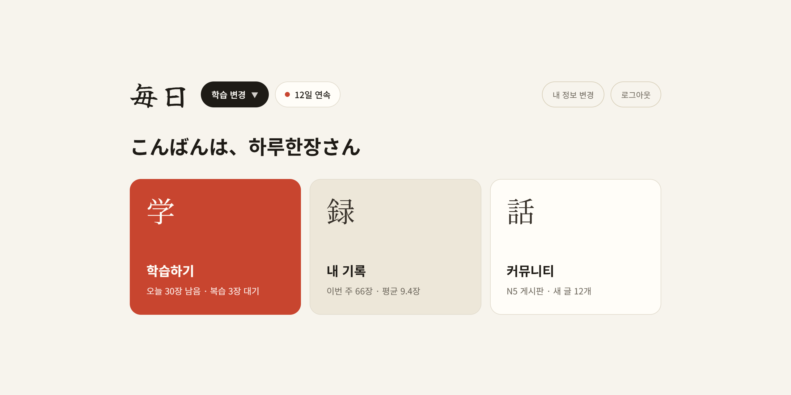
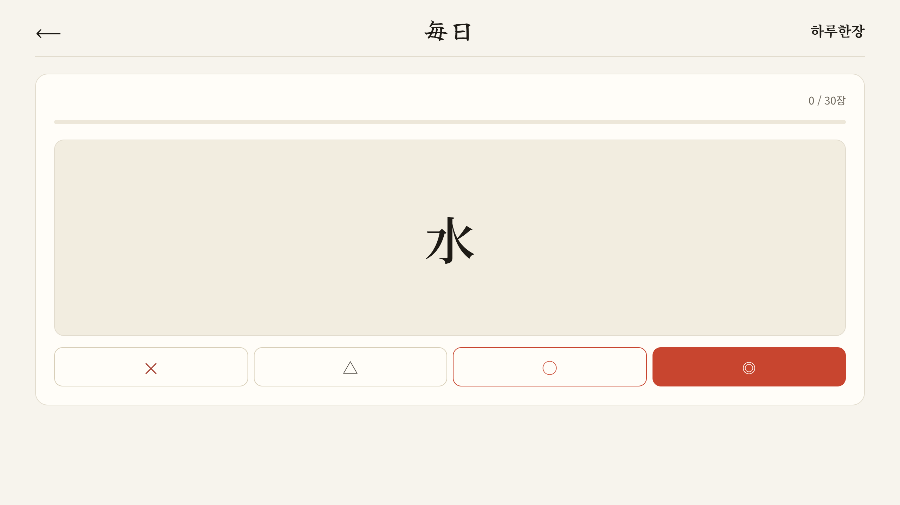
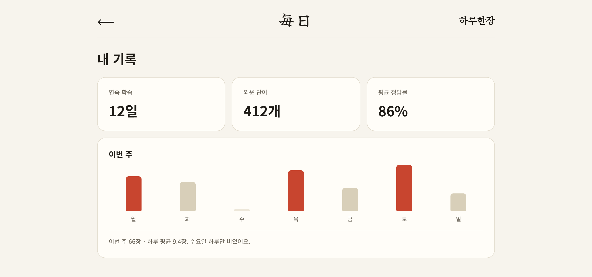
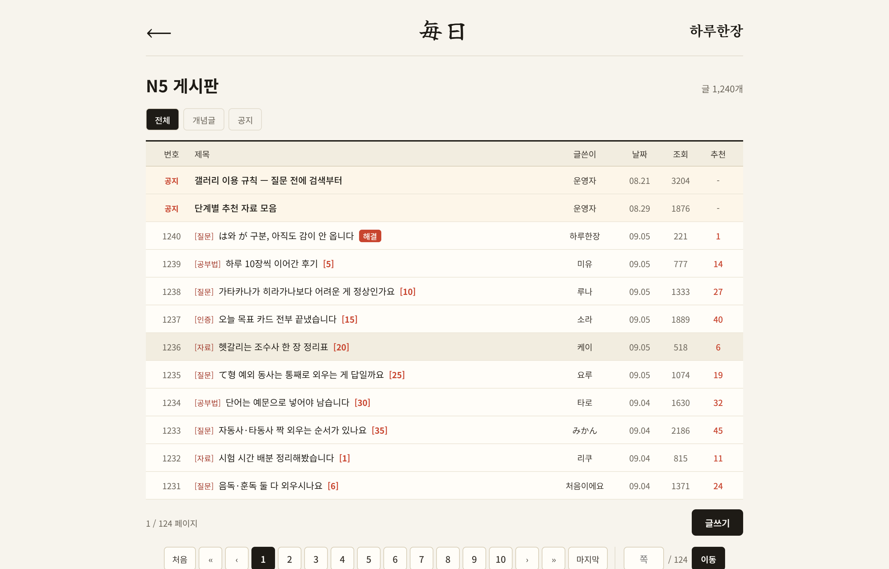

# 毎日 Mainichi

매일 조금씩 공부하는 JLPT 일본어 학습 웹 서비스입니다.
FSRS-5 알고리즘으로 카드마다 복습 시점을 계산하고, 그날 새로 배운 단어로 AI가 JLPT 형식 독해·청해 문제를 만들어 줍니다.



## 주요 기능

| 기능 | 설명 |
| --- | --- |
| FSRS 복습 | ✕ △ ○ ◎ 4단계 평가로 카드마다 기억 안정도·난이도를 계산해 다음 복습일을 정함 (py-fsrs 5.x 식을 Java로 구현) |
| 덱 | 히라가나·가타카나 142장, JLPT N5~N1 단어 500장, 기초~N1 문법 193장 |
| AI 독해 | 오늘 배운 단어로 지문 1개 + 4지선다 2문항, 해석·해설 |
| AI 청해 | 남녀 대화 스크립트를 브라우저 음성(Web Speech API)으로 재생, 후리가나 읽기로 한자 오독 방지 |
| 학습 통계 | 사용자 시간대 기준 하루로 집계한 복습 기록·연속 학습일·카드 상태 |
| 단계별 게시판 | 레벨별 글·댓글 |
| 로그인 | 카카오 로그인, JWT Access Token + HttpOnly 쿠키 Refresh Token |

| 단어 카드 | 내 기록 |
| --- | --- |
|  |  |



> 화면은 기획 단계 목업이며, 숫자와 게시글은 예시 데이터입니다.

## 기술 스택

- **Backend**: Java 17, Spring Boot 4.1, Spring Security, JPA, MySQL
- **Frontend**: React 19, TypeScript, Vite, React Router
- **AI**: Gemini(기본) / Claude(선택), `QuizGenerator` 인터페이스로 교체
- **Test**: JUnit 5, H2 인메모리 DB로 전체 컨텍스트 통합 테스트 (118개)

## 구조

```
mainichi/
├── api/api/   # Spring Boot 백엔드 (auth · user · card · study · quiz · stats · board)
└── web/       # React 프론트엔드
```

AI 응답은 서버에서 형식(문제 2개, 보기 4개, 정답 0~3, 대사 2~30줄)을 다시 검증한 뒤에만 저장합니다.
AI 호출은 트랜잭션 밖에서 해서, AI가 느려져도 DB 커넥션을 붙잡지 않습니다.

## 설계하면서 신경 쓴 점

- **AI 응답 실패 대응**: 실패 유형별 로그, 일시 오류·형식 오류는 1회 재시도, 사용량 한도(429)는 즉시 안내
- **시간대**: 서버가 UTC로 배포되어도 사용자의 "오늘"이 어긋나지 않도록 하루 계산을 `StudyDay`로 통일
- **N+1 방지**: 연관관계는 모두 `LAZY`, 목록은 DTO 프로젝션, 상세는 `join fetch`, `open-in-view: false`
- **테스트 가능한 구조**: FSRS 계산은 스프링에 의존하지 않는 순수 클래스, 현재 시각은 `Clock` 주입

## 실행 방법

### 1. 백엔드

MySQL에 `mainichi` 데이터베이스와 `mainichi_user` 계정을 만든 뒤 환경 변수를 설정합니다.

| 환경 변수 | 설명 |
| --- | --- |
| `DB_PASSWORD` | MySQL `mainichi_user` 비밀번호 (필수) |
| `KAKAO_CLIENT_ID` | 카카오 REST API 키 (필수) |
| `KAKAO_CLIENT_SECRET` | 카카오 Client Secret을 켠 경우 |
| `JWT_SECRET` | JWT 서명 키, 운영에서는 32바이트 이상 랜덤 문자열 |
| `GEMINI_API_KEY` | 문제 생성용 (없으면 문제 생성만 503) |
| `QUIZ_GENERATOR` | `gemini`(기본) 또는 `claude` |
| `ANTHROPIC_API_KEY` | `QUIZ_GENERATOR=claude`일 때 |

```bash
cd api/api
./gradlew bootRun    # http://localhost:8080
```

테스트는 MySQL 없이 H2로 실행됩니다.

```bash
cd api/api
./gradlew test
```

### 2. 프론트엔드

```bash
cd web
npm install
cp .env.example .env    # VITE_KAKAO_REST_API_KEY 입력
npm run dev             # http://localhost:5173
```

카카오 로그인 설정은 [web/README.md](web/README.md)를 참고하세요.
